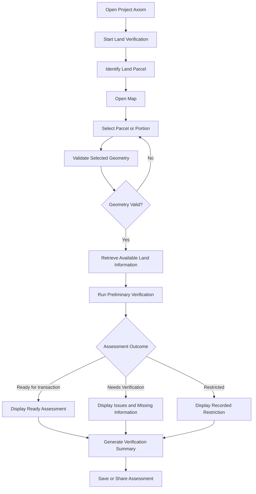

# Project Axiom
## Land Transaction Pre-Flight Check
### Spot Problems Before a Transaction Starts

**NESFIC Problem Statement:** NESFIC-D-51  
**Official Challenge:** [Land Transaction Pre-Flight Check](https://startup.assam.gov.in/nesfic26/problem-statements/nesfic-d-51)  
**Document Type:** Product Requirements Document (PRD)  
**Product Category:** GovTech / Land Records / Digital Public Infrastructure  
**Current Release:** Prototype — NESFIC 2026  
**Document Status:** Draft — Product Definition  
**Primary Geography:** Assam, India

---

# 1. Executive Summary

## 1.1 Product Overview

Project Axiom is a digital land transaction pre-flight verification system designed to identify potential ownership discrepancies, land restrictions, encumbrances, area mismatches, and other record-related issues before a land transaction or land-related service is initiated.

Land transactions in Assam involve the examination of several aspects of a parcel, including ownership, area, land classification, Government restrictions, encumbrances, and other relevant entries. These records may be distributed across different databases, registers, documents, and administrative systems.

Issues that are identified late in the transaction process can lead to delays, repeated document submissions, application rejection, disputes, or litigation.

Project Axiom introduces a preliminary digital verification mechanism that consolidates available land information, allows users to identify a specific parcel or portion of a parcel, and evaluates the available information against defined verification conditions.

The system produces a comprehensible pre-flight assessment with one of three primary outcomes:

- `Ready for transaction`
- `Needs Verification`
- `Restricted`

Every assessment must include the reasons behind its outcome, the information examined, and the conditions that remain unresolved.

Project Axiom is intended to support citizens, buyers, sellers, Revenue Circle officials, registration officials, banks, legal practitioners, and other Government authorities.

## 1.2 Product Vision

To make land transactions in Assam more transparent, traceable, and predictable by enabling preliminary verification of land records before a transaction begins.

## 1.3 Product Mission

Reduce avoidable transaction delays and administrative effort by making relevant land information easier to identify, examine, and verify.

## 1.4 Core Product Proposition

**Know what needs to be verified before initiating a land transaction.**

Project Axiom should enable a user to:

1. Identify a land parcel using available cadastral or geographical information.
2. Select the exact area of land intended for a transaction.
3. Examine the available land records associated with that area.
4. Identify potential restrictions, inconsistencies, or unresolved conditions.
5. Understand why the selected land is classified as ready, requiring verification, or restricted.
6. Generate a preliminary assessment that can support further verification by the relevant authorities.

## 1.5 Product Boundary

Project Axiom is not intended to replace:

- Official land records.
- Revenue authorities.
- Registration authorities.
- Existing land-record management systems.
- Legal due diligence.
- Official cadastral surveys.
- Judicial proceedings.
- Statutory approval processes.

The system must not present its preliminary assessment as a legal clearance, title certificate, ownership guarantee, or substitute for verification by the competent authority.

---

# 2. Problem Statement

## 2.1 Official Problem Description

Land transactions and services such as registration, mutation, partition, and settlement require verification of several aspects of a parcel, including ownership, area, land category, Government restrictions, encumbrances, and other relevant entries.

Many issues are detected only after an application or transaction has already been initiated.

This may lead to:

- Avoidable delays.
- Repeated document submission.
- Application rejection.
- Litigation.
- Additional administrative effort.

Officials also have to examine information available across different records and systems.

## 2.2 Existing Process

The current process involves examination of relevant records and documents by competent officials during the processing of an application or transaction.

The checks may involve:

- Multiple databases.
- Physical registers.
- Land-related documents.
- Field reports.
- Revenue records.
- Other relevant administrative information.

The exact process and records involved may vary depending on the nature of the transaction and the applicable administrative procedure.

## 2.3 Identified Product Opportunity

Project Axiom addresses the information-verification stage that precedes or accompanies the initiation of a land transaction.

The opportunity is to provide a unified interface through which relevant information can be identified, examined, and flagged before avoidable problems become more expensive to resolve.

The system should not merely display land records. It should help users understand whether the available information is consistent with the proposed transaction and whether further verification is necessary.

## 2.4 Core Problem Hypothesis

If users can examine the relevant available land information before initiating a transaction, then:

- Potential discrepancies can be identified earlier.
- Users can prepare the required documents more effectively.
- Buyers and sellers can make more informed decisions.
- Officials can receive better-prepared applications.
- Repeated verification effort may be reduced.
- The probability of avoidable transaction delays may decrease.

These are hypotheses to validate through the prototype and subsequent stakeholder feedback.

## 2.5 Transaction Preparation and Administrative Complexity

Land transactions in Assam may involve multiple stages of document preparation, administrative verification, approval, registration, and subsequent updating of land records.

The information gathered for Project Axiom indicates that a monetary land sale may involve:

- Preparation of a sale agreement between the buyer and seller.
- Application for a No Objection Certificate (NOC) for transfer of immovable property.
- Submission of identity documents and land-related records.
- Examination of the application by relevant revenue authorities.
- Administrative approval by the competent authority.
- Registration of the transaction.
- Subsequent mutation or updating of the land records.

The process may involve both digital and physical document submission, as well as interaction with multiple administrative offices.

The exact requirements may vary according to the transaction, land classification, location, and applicable administrative procedure.

Project Axiom should help users identify potential issues and prepare the relevant information before entering the formal transaction process.

The product must distinguish between preliminary verification, document readiness, and official administrative approval.

---

# 3. Product Goals and Objectives

## 3.1 Primary Objective

Enable preliminary verification of a selected land parcel or a portion of a parcel before a land transaction is initiated.

## 3.2 Primary Product Goals

- **G-01: Improve Preliminary Verification**: Allow users to examine available ownership, area, land classification, restriction, encumbrance, and other relevant information.
- **G-02: Enable Precise Land Selection**: 
Allow users to identify the exact geographical area intended for a transaction, including a portion of an existing parcel.
- **G-03: Surface Potential Issues Early**: 
Identify conditions that may require additional verification, prevent an unqualified readiness assessment, or indicate a recorded restriction.
- **G-04: Improve Explainability**: 
Ensure that every assessment includes understandable reasons and supporting information.
- **G-05: Preserve Record Integrity**: 
Ensure that changes to records, where permitted, are controlled, traceable, and attributable.
- **G-06: Support Multiple Stakeholders**: 
Provide role-appropriate interfaces for citizens, buyers, sellers, and relevant Government personnel (revenue circle officers, registration officers, banks and legal practitioners)
- **G-07: Establish a Foundation for Government Integration**: 
Design the product so that it can eventually work with authoritative land-record systems and administrative workflows, subject to authorization and integration availability.

## 3.3 Non-Goals

The prototype is not intended to:

- Establish legal ownership independently.
- Guarantee that a transaction is legally valid.
- Replace official land-record systems.
- Replace cadastral surveys.
- Automatically approve land registration.
- Automatically approve mutation.
- Issue legally binding certificates.
- Resolve ownership disputes.
- Determine the legal validity of every document.
- Automatically remove Government restrictions.
- Replace judicial or administrative decisions.
- Provide unrestricted editing of official land records.
- Claim access to Government databases that have not been integrated.
- Treat satellite imagery as proof of ownership or legal boundaries.

---

# 4. Product Scope

Project Axiom is divided into two distinct product horizons.

## 4.1 Horizon A — NESFIC Prototype

The prototype demonstrates the central product proposition: preliminary verification of a selected land parcel or sub-parcel.

The prototype should be a web-based application deployed on Vercel, with Supabase providing the database and associated backend services.

The prototype must demonstrate:

- A land-focused application interface.
- A map-based land selection workflow.
- Polygon-based selection of a land parcel or portion of a parcel.
- Basic geographical and area calculations.
- A land information panel.
- A preliminary verification engine.
- The three primary assessment outcomes.
- Explanations for identified issues.
- A verification report or summary.
- A demonstrable record of the assessment.
- Ownership and mutation history examination.
- Administrative dashboards.
- Field-survey workflows.
- Record creation and modification workflows.
- Controlled mutation workflows.
- Record archival and deletion workflows.

The prototype may use seeded, simulated, or manually entered land information where authoritative data integrations are unavailable.

Any such data must be clearly identified as demonstration data.

## 4.2 Horizon B — Future Product

The eventual product may include:

- Integration with authoritative land-record systems.
- Integration with cadastral mapping systems.
- Official land-record retrieval.
- Government-land restriction verification.
- Encumbrance verification.
- Court-related entry verification.
- Official audit trails.
- Document verification.
- Administrative review and escalation.
- Interdepartmental workflows.
- Officially authorized transaction reports.

These capabilities are part of the broader product vision and are not automatically included in the NESFIC prototype.

## 4.3 Scope Classification

| Capability | NESFIC Prototype | Future Product |
|---|---|---|
| Web-based application | Must Have | Must Have |
| Map-based land selection | Must Have | Must Have |
| Polygon drawing | Must Have | Must Have |
| Partial parcel selection | Must Have | Must Have |
| Area calculation | Must Have | Must Have |
| Demonstration land records | Must Have | Optional |
| Preliminary verification engine | Must Have | Must Have |
| Three assessment outcomes | Must Have | Must Have |
| Explanation of flagged issues | Must Have | Must Have |
| Verification summary | Must Have | Must Have |
| Document-readiness assessment | Should Have | Must Have |
| Authentication | Should Have | Must Have |
| Persistent assessment history | Should Have | Must Have |
| Official land-record integration | Out of Scope | Must Have |
| Official cadastral data integration | Out of Scope unless available | Must Have |
| Official record creation | Out of Scope | Must Have |
| Official mutation | Out of Scope | Must Have |
| Official record deletion | Out of Scope | Must Have |
| Government employee dashboards | Limited demonstration | Must Have |
| Administrative approval workflows | Out of Scope | Must Have |
| Legally binding clearance | Out of Scope | Out of Scope for the product's preliminary assessment |

---

# 5. Target Users and Stakeholders

## 5.1 Citizens

Citizens who own, possess, intend to acquire, or otherwise have an interest in a land parcel.

### User Needs

- Identify their land.
- Understand the available land information.
- Examine potential discrepancies.
- Determine whether further verification is required.
- Understand the status of a proposed transaction.

## 5.2 Buyers

Individuals or entities intending to purchase land.

### User Needs

- Identify the exact land being considered for purchase.
- Understand the recorded ownership information.
- Identify potential restrictions.
- Check whether the proposed area corresponds to available records.
- Identify issues requiring professional or official verification.

## 5.3 Sellers

Individuals or entities intending to sell land.

### User Needs

- Identify the land intended for sale.
- Understand the available record information.
- Identify discrepancies before initiating a transaction.
- Prepare information required by the buyer or relevant authorities.

## 5.4 Revenue Circle Officials

Officials involved in the examination and processing of land-related records and applications.

### User Needs

- Examine relevant land information.
- Identify inconsistencies.
- Review preliminary assessments.
- Access relevant record history.
- Understand which conditions require further verification.

## 5.5 Registration Officials

Officials involved in registration-related processes.

### User Needs

- Examine relevant land information.
- Identify potential restrictions or discrepancies.
- Review available pre-transaction verification information.
- Identify issues that may require additional examination.

## 5.6 Field Survey Officers

Personnel responsible for field-level verification and survey-related activities.

### User Needs

- Identify the geographical area requiring verification.
- Examine parcel boundaries.
- Understand reported discrepancies between maps and records.
- Access information relevant to field verification.
- Record findings through authorized workflows.

## 5.7 District Commissioner

The District Commissioner and relevant district-level authorities.

### User Needs

- Access district-level information.
- Monitor verification activities.
- Identify unresolved cases.
- Review relevant administrative summaries.
- Monitor record integrity and verification processes.

## 5.8 Banks and Financial Institutions

Institutions examining land information in connection with lending, collateral, or other financial activities.

### User Needs

- Identify relevant land records.
- Examine available ownership and encumbrance information.
- Identify potential restrictions.
- Obtain a preliminary assessment for further due diligence.

Project Axiom must not present its assessment as a substitute for the institution's independent legal and financial due diligence.

## 5.9 Legal Practitioners

Legal professionals involved in land transactions and land-related disputes.

### User Needs

- Examine available land information.
- Identify potential inconsistencies.
- Understand the sources and dates of the information.
- Use the assessment as an aid to further legal examination.

## 5.10 Government Authorities

Other relevant personnel within the Revenue & Disaster Management Department of Assam and associated Government authorities.

### User Needs

- Access relevant records.
- Examine verification results.
- Review changes to records.
- Maintain traceability.
- Perform authorized administrative activities.

---

# 6. Product Principles

## 6.1 Explainability Over Opaque Decisions

The system must not produce a status without explaining the underlying conditions.

A user must be able to understand:

- What was examined.
- What was found.
- Which conditions were satisfied.
- Which conditions were not satisfied.
- Which conditions could not be evaluated.
- Why the final assessment was produced.

## 6.2 Data Provenance

Every material piece of land information should have an identifiable source.

Where available, the system should record:

- Source system.
- Source record identifier.
- Retrieval or verification timestamp.
- Source document reference.
- Data freshness.
- Verification method.

## 6.3 No False Certainty

Missing information must not be interpreted as proof that no restriction, encumbrance, dispute, or discrepancy exists.

The absence of a recorded issue in the available information does not establish the legal validity of a transaction.

## 6.4 Geographical Precision

The system must distinguish between:

- A parcel's recorded boundary.
- A boundary drawn by a user.
- A satellite-image interpretation.
- A field-survey boundary.
- A legally established cadastral boundary.

These representations must not be treated as interchangeable.

## 6.5 Controlled Record Modification

Official records must not be modified without appropriate authorization.

Every authorized change must be attributable and traceable.

## 6.6 Human Oversight

The system should assist citizens and officials in identifying issues, not independently replace competent administrative or legal judgment.

## 6.7 Progressive Verification

The system should allow the user to move from preliminary information to more detailed verification without requiring every source of information to be available at the beginning.

---

# 7. Core Product Workflow

## 7.1 Primary User Journey

The primary journey begins when a user intends to transact a specific piece of land.

The user must be able to identify the land, select the intended transaction area, examine available information, and receive a preliminary assessment.

## 7.2 Primary Workflow Requirements

The application must:

1. Allow a user to start a new verification.
2. Provide a method for identifying a land parcel.
3. Allow the user to open the geographical selection interface.
4. Allow the user to select a complete parcel or a portion of a parcel.
5. Validate the selected geometry.
6. Associate the selected geometry with available land information.
7. Execute the preliminary verification checks.
8. Produce an assessment outcome.
9. Explain the outcome.
10. Allow the user to review the assessment.
11. Allow the user to save or export the assessment where supported.

## 7.3 Assessment Lifecycle

An assessment should have a distinguishable lifecycle.

Suggested lifecycle states:

- `Draft`
- `Geometry Selected`
- `Verification In Progress`
- `Completed`
- `Failed`
- `Archived`

These lifecycle states are distinct from the assessment outcomes.

For example, an assessment may be:

- `Completed` with an outcome of `Ready for transaction`.
- `Completed` with an outcome of `Needs Verification`.
- `Completed` with an outcome of `Restricted`.

A failed assessment must not be presented as a successful verification.

## 7.4 Assam Land Sale Transaction Workflow — Domain Reference

The following workflow represents the land-sale process gathered during domain research for Project Axiom.

It is intended to provide context for the product's document-readiness and pre-transaction verification capabilities.

The workflow has not been established as a universal procedure for every land transaction in Assam. Its applicability and individual steps must be validated against the relevant official procedure.

### Stage 1 — Transaction Preparation

1. The buyer and seller prepare a deed or agreement for the proposed land sale.
2. The parties identify the land and the area intended for transfer.
3. The relevant application for transfer of immovable property is prepared.
4. Required identity documents, land records, and supporting documents are collected.
5. Where applicable, additional consent, NOCs, affidavits, or Power of Attorney documents are prepared.

### Stage 2 — Application and Administrative Examination

6. The application is submitted through the applicable administrative channel.
7. Supporting documents are submitted as required.
8. The relevant revenue authorities examine the application and land information.
9. A hearing, field verification, or additional examination may be conducted where required.
10. The application is forwarded to the competent authority for the relevant decision.

### Stage 3 — NOC and Registration

11. The competent authority issues the applicable NOC for transfer of immovable property.
12. The transaction proceeds to registration subject to the applicable requirements.
13. Stamp duty and registration fee formalities are completed.
14. The registration report and associated information are made available to the relevant revenue authorities.

### Stage 4 — Mutation and Record Updating

15. Following registration, the relevant mutation or record-update process is initiated.
16. The competent authority examines and processes the mutation according to the applicable procedure.
17. The land records are updated following the relevant mutation decision.
18. Where applicable, partition and associated record updates may follow.

### Project Axiom's Role

Project Axiom is intended to support the preparation and preliminary verification stages.

The application may help users identify:

- Missing information.
- Potential record discrepancies.
- Relevant document requirements.
- Potential restrictions.
- Unresolved conditions requiring further examination.

Project Axiom does not issue the NOC, approve the transaction, perform official registration, or independently authorize mutation.

These functions remain with the competent authorities and the relevant Government systems.

---

# 8. Core Feature: Map-Based Land Selection

## 8.1 Overview

The most important geographical capability of Project Axiom is the ability to identify the exact perimeter of the land intended for a transaction.

A user may intend to purchase:

- An entire existing parcel.
- Half of an existing parcel.
- A specific rectangular portion.
- An irregular portion of a parcel.
- A portion that shares boundaries with several neighboring parcels.

The system must support the identification of the intended transaction area independently of the full area of the original parcel.

## 8.2 Primary Use Case

A buyer intends to purchase half of a plot owned by a seller.

The original plot is surrounded by neighboring plots owned by different individuals or entities.

The buyer and seller must be able to identify the exact portion intended for the transaction.

The system should allow the user to draw a polygon representing the intended transaction area and examine how that polygon relates to the original parcel and surrounding parcels.

The selected polygon should be distinguishable from:

- The original parcel boundary.
- Neighboring parcel boundaries.
- Other geographical features.
- The underlying map or satellite imagery.

## 8.3 Map Interface Requirements

The map interface must provide:

- A geographical map.
- Zoom controls.
- Pan controls.
- A method for locating a parcel.
- A polygon drawing tool.
- A polygon editing mechanism.
- A polygon deletion or reset mechanism.
- A visible representation of the selected area.
- A visible representation of relevant parcel boundaries where data is available.
- A calculated area for the selected geometry.
- A clear indication of whether the geometry is valid.

The interface should support satellite imagery where an appropriate map source is available.

## 8.4 Polygon Drawing Requirements

The user must be able to:

1. Enter selection mode.
2. Place the first vertex.
3. Place additional vertices.
4. Close the polygon.
5. Inspect the resulting geometry.
6. Move or edit vertices.
7. Remove vertices where supported.
8. Reset the selection.
9. Confirm the selected geometry.

The polygon must be represented as a closed geometry.

The interface should provide a clear visual indication when the polygon is incomplete.

## 8.5 Geometry Validation

The system must validate the selected polygon before initiating verification.

### Required Checks

| ID | Validation | Expected Behavior |
|---|---|---|
| GEO-01 | Polygon closure | Ensure the polygon is closed |
| GEO-02 | Minimum vertices | Reject geometries with insufficient vertices |
| GEO-03 | Self-intersection | Detect invalid self-intersecting polygons |
| GEO-04 | Zero-area geometry | Reject polygons with no meaningful area |
| GEO-05 | Coordinate validity | Ensure coordinates are valid |
| GEO-06 | Geometry existence | Ensure a geometry has been selected |
| GEO-07 | Area calculation | Calculate the area of the selected polygon |

### Additional Checks

Where cadastral parcel boundaries are available:

- Identify whether the selected polygon lies within the intended parcel.
- Identify whether the polygon overlaps neighboring parcels.
- Identify whether the polygon extends outside the original parcel.
- Identify whether the selected polygon intersects a recorded boundary.
- Identify whether the selection corresponds to more than one parcel.

These checks must be performed using appropriate geographical data.

A polygon drawn over satellite imagery alone cannot establish whether the selected area corresponds to the legally recorded parcel.

## 8.6 Constrained Selection

The product should support constrained land selection.

Constrained selection means that the user is not selecting an arbitrary geographical region without context.

Instead, the selection is associated with an identified parcel and its relevant boundaries.

The intended behavior is:

1. Identify the original parcel.
2. Display the parcel boundary where authoritative or suitable cadastral data is available.
3. Allow the user to select a portion of that parcel.
4. Validate the selected geometry against the original parcel.
5. Identify any overlap or boundary mismatch.
6. Preserve the relationship between the original parcel and the selected portion.

The system should not silently modify the user's geometry to force it inside a parcel.

If a correction is required, the interface should explain the problem and allow the user to edit the geometry.

## 8.7 Partial Parcel Selection

The system must support the distinction between:

- The original parcel.
- The selected transaction area.
- The remaining area of the original parcel.

Where the relevant geometry and source data are available, the system should calculate:

- Original parcel area.
- Selected transaction area.
- Remaining area.
- Percentage of the original parcel selected.

The remaining area must be calculated from the original parcel geometry and selected geometry, rather than merely subtracting two potentially inconsistent reported area values.

## 8.8 Area Calculation

The system must calculate the geographical area of the selected polygon.

The displayed area should include:

- Numeric area.
- Unit of measurement.
- Precision appropriate to the use case.

The system should support the conversion of area into relevant units, subject to the availability of accurate conversion rules.

Potential units include:

- Square metres.
- Square feet.
- Hectares.
- Acres.

Traditional land-area units can vary by region. Hence, it must be avoided for the prototype build.

## 8.9 Map Data Sources

The prototype may use:

- A suitable satellite or base map provider.
- Available cadastral map data.
- Demonstration parcel geometries.
- Manually entered parcel boundaries.
- User-drawn geometries.

The official cadastral mapping system, Bhunaksha, is a potential source of relevant parcel-boundary information.

However, the availability of a public interface does not automatically imply that its data can be accessed programmatically, redistributed, or integrated into a third-party application.

The prototype must not claim official Bhunaksha integration unless that integration is actually implemented and authorized.

## 8.10 Map Data Limitations

The interface must distinguish between:

- Satellite imagery.
- Cadastral boundaries.
- User-drawn boundaries.
- Officially verified boundaries.

Satellite imagery may provide visual context, but it must not be treated as a definitive representation of legal land boundaries.

The map interface should clearly communicate when parcel-boundary information is unavailable or unverified.

---

# 9. Land Information and Record Examination

## 9.1 Overview

After a user selects a parcel or portion of a parcel, the system must examine the available information associated with that land.

The purpose is to provide the information necessary for preliminary verification.

## 9.2 Land Information Categories

The system should support examination of the following categories.

### A. Parcel Identification

Relevant information may include:

- District.
- Revenue Circle.
- Village.
- Mouza.
- Patta number.
- Dag number.
- Parcel identifier.
- Recorded area.
- Geographical boundary.

The availability of each field may depend on the source record.

### B. Ownership Information

Relevant information may include:

- Recorded owner name.
- Ownership-related record identifier.
- Ownership status.
- Recorded share or interest, where available.
- Ownership history, where available.

The system must distinguish recorded ownership information from independently verified legal title.

### C. Land Classification

Relevant information may include:

- Recorded land category.
- Land-use classification.
- Applicable restrictions associated with the classification.
- Classification-related discrepancies.

The system must not infer a legal land category solely from satellite imagery.

### D. Government Restrictions

Relevant information may include:

- Recorded Government-land status.
- Restrictions associated with the parcel.
- Relevant administrative entries.
- Other specified conditions that may affect the proposed transaction.

The system must identify the source of each restriction.

### E. Encumbrances

Relevant information may include recorded encumbrances or other entries relevant to the transaction.

Where such information is unavailable, the system must indicate that the relevant check could not be completed.

### F. Court-Related Entries

Relevant information may include recorded court-related entries associated with the parcel.

The system must distinguish between:

- A recorded court-related entry.
- A verified current judicial restriction.
- A user-provided statement.
- An unresolved or unverified reference.

The prototype must not claim to determine the complete legal status of a property dispute.

### G. Area and Boundary Information

Relevant information may include:

- Recorded area.
- Calculated geographical area.
- Selected transaction area.
- Original parcel area.
- Area discrepancy.
- Map-record mismatch.

### H. Other Relevant Entries

The system should be extensible to additional verification conditions specified by the relevant authorities.

---

# 10. Preliminary Verification Engine

## 10.1 Overview

The preliminary verification engine is the central decision-support component of Project Axiom.

It examines the available land information and produces a preliminary assessment.

The engine must not simply return a status.

It must return a status with reasons.

## 10.2 Primary Assessment Outcomes

The system must support exactly three primary outcomes for a completed assessment.

### `Ready for transaction`

The available information has been examined against the configured checks, and no unresolved issue or recorded restriction has been identified within the scope of those checks.

This outcome does not establish legal validity or guarantee that the transaction can proceed.

### `Needs Verification`

The available information contains a discrepancy, missing information, an unresolved condition, or another issue requiring further examination.

The system should explain what requires verification.

### `Restricted`

The available information identifies a recorded restriction or condition that prevents the system from presenting the selected land as ready for transaction.

The system should identify the relevant restriction and its source.

A `Restricted` outcome must not be interpreted as a judicial determination or a definitive legal conclusion unless an appropriately authorized process establishes that status.

## 10.3 Assessment Rules

The assessment engine must apply the following general principles:

1. A recorded restriction must not be ignored.
2. A missing record must not be treated as a clean record.
3. An unresolved discrepancy must not be treated as a verified match.
4. An invalid polygon must not proceed to a completed assessment.
5. The absence of a detected issue must not be presented as proof of legal validity.
6. Every non-ready outcome must include an explanation.
7. The assessment must identify the checks that were performed.
8. The assessment must identify the checks that could not be performed.
9. The assessment must preserve the information used to produce the result.
10. The result must be reproducible from the recorded assessment inputs and applicable verification rules.

## 10.4 Verification Rule Categories

| Rule Category | Example Condition | Potential Outcome |
|---|---|---|
| Ownership | Ownership information is missing | Needs Verification |
| Ownership | Recorded ownership does not match the provided information | Needs Verification |
| Area | Recorded area differs from the calculated area | Needs Verification |
| Land Classification | Classification-related information is inconsistent | Needs Verification |
| Government Restriction | A recorded restriction is identified | Restricted |
| Encumbrance | A recorded encumbrance requires examination | Needs Verification |
| Court-Related Entry | A relevant court-related entry is identified | Needs Verification |
| Boundary | Selected polygon extends outside the identified parcel | Needs Verification |
| Boundary | The selected geometry is invalid | Verification cannot be completed |
| Data Availability | A required source is unavailable | Needs Verification |
| Data Freshness | Relevant information is outdated | Needs Verification |
| Record Integrity | Relevant information is inconsistent across sources | Needs Verification |

The precise outcome associated with a particular condition must be configurable according to the applicable rules and authoritative guidance.

A recorded encumbrance or court-related entry must not automatically be treated as a definitive legal prohibition unless the applicable rule establishes that conclusion.

## 10.5 Assessment Result Structure

Every completed assessment should contain:

- Assessment identifier.
- Assessment timestamp.
- Selected land geometry.
- Original parcel identifier, where available.
- Selected transaction area.
- Verification outcome.
- Summary of findings.
- List of verification checks.
- List of identified issues.
- List of unresolved conditions.
- List of unavailable checks.
- Relevant source information.
- Data freshness information.
- Applicable verification-rule version.
- Disclaimer.

## 10.6 Explainability Requirements

For every identified issue, the system must provide:

- A human-readable title.
- A description of the condition.
- The relevant land information.
- The source of the information, where available.
- The reason the condition matters.
- The recommended next step.
- Whether the issue prevents a readiness assessment.

### Example:

**Issue:** Recorded area mismatch 
**Description:** The calculated area of the selected geographical boundary differs from the area recorded in the available land information. 
**Reason:** The difference may indicate an incorrect boundary, an inaccurate area entry, or a mismatch between the geographical representation and the land record. 
**Recommended action:** Verify the boundary and recorded area against the relevant authoritative records.

The system must not automatically conclude that the recorded area is incorrect.

## 10.7 Assessment Precedence

The system should apply a deterministic assessment policy.

A proposed precedence is:

1. Reject invalid or incomplete geometry before verification.
2. Identify applicable verification rules.
3. Evaluate available information.
4. Identify recorded restrictions.
5. Identify unresolved discrepancies.
6. Identify missing or unavailable information.
7. Determine the final outcome.

For completed assessments:

- If a qualifying restriction is identified, the outcome is `Restricted`.
- Otherwise, if an unresolved condition or incomplete verification exists, the outcome is `Needs Verification`.
- Otherwise, the outcome is `Ready for transaction`.

The presence of a restriction must not suppress the display of other relevant issues.

The system should display all material findings even when one finding determines the primary outcome.

## 10.8 Document Readiness Assessment

The system should provide a preliminary document-readiness assessment for a proposed monetary land transaction.

The document-readiness assessment is distinct from the geographical verification of the selected land.

Its purpose is to help users understand whether the information and documents relevant to the proposed transaction have been provided.

The assessment should identify:

- Documents that may be required.
- Documents provided by the user.
- Documents that are missing.
- Documents that may not be applicable.
- Documents requiring further examination.
- Documents whose authenticity or validity has not been verified.

The document checklist must be configurable according to the applicable transaction type and administrative requirements.

The system must not treat the presence of a document as proof of its legal validity.

The document-readiness assessment must not independently determine whether the transaction is legally permissible.

### Document Statuses

The prototype should support the following statuses:

- `Missing`
- `Provided`
- `Not Applicable`

A future administrative workflow may introduce additional statuses, such as:

- `Under Examination`
- `Verified`
- `Rejected`
- `Requires Resubmission`

These additional statuses must only be used when the corresponding examination or decision has actually occurred.

### Assessment Relationship

The document-readiness assessment must remain separate from the primary land verification outcome.

A transaction may have complete documentation while still containing an unresolved land-record discrepancy.

Similarly, a parcel may have no identified land-record discrepancy while the required transaction documents remain incomplete.

The system must preserve this distinction.

---

# 11. Verification Report

## 11.1 Overview

The verification report is the primary output of Project Axiom.

It provides a summary of the selected land, the available information, the checks performed, and the resulting assessment.

## 11.2 Report Requirements

The report must include:

### Assessment Summary

- Assessment identifier.
- Assessment date and time.
- Primary assessment outcome.
- Summary of the selected land.

### Geographical Information

- Selected polygon.
- Original parcel boundary, where available.
- Selected area.
- Original parcel area, where available.
- Remaining area, where applicable.

### Land Information

- Available parcel identifiers.
- Available ownership information.
- Available land classification.
- Relevant restrictions.
- Relevant encumbrance information.
- Relevant court-related entries.
- Other available information.

### Verification Results

- Checks performed.
- Checks passed.
- Checks requiring further verification.
- Checks that could not be performed.
- Recorded restrictions.
- Identified discrepancies.

### Source Information

- Source record references.
- Source system.
- Retrieval or verification timestamp.
- Data freshness information.

### Disclaimer

The report must communicate that the assessment is preliminary and does not constitute a legal clearance, title certificate, or guarantee of transaction validity.

## 11.3 Report Export

For the prototype, the report should be viewable within the application.

Export to PDF is a desirable capability.

The system should not represent an exported report as an official Government certificate.

---

# 12. User Dashboards and Role-Based Interfaces

## 12.1 Overview

The eventual product must provide different dashboards for different categories of users.

The interface should expose only the functionality relevant to the user's role and authorization.

## 12.2 Citizen Dashboard

The citizen dashboard should provide:

- Start a new verification.
- Identify land.
- View previous assessments.
- Open assessment details.
- Review identified issues.
- Access saved reports.
- View assessment status.

## 12.3 Buyer and Seller Dashboard

The buyer and seller interface should provide:

- Land selection.
- Transaction-area selection.
- Preliminary verification.
- Assessment history.
- Assessment report access.
- Relevant information-sharing capabilities, where authorized.

The interface must not imply that a buyer or seller has authority to modify official land records.

## 12.4 District Commissioner Dashboard

The future District Commissioner dashboard may provide:

- District-level verification summaries.
- Administrative activity summaries.
- Relevant unresolved cases.
- Verification trends.
- Record-integrity indicators.
- Authorized access to relevant records.

These capabilities require appropriate data access and administrative authorization.

## 12.5 Revenue Circle Officer Dashboard

The future Revenue Circle dashboard may provide:

- Circle-level verification cases.
- Relevant land records.
- Preliminary assessment results.
- Record discrepancies.
- Cases requiring examination.
- Relevant audit history.
- Authorized administrative actions.

## 12.6 Field Survey Officer Dashboard

The future Field Survey dashboard may provide:

- Assigned verification activities.
- Relevant parcel boundaries.
- Selected transaction geometries.
- Map-record discrepancy information.
- Field verification findings.
- Relevant document references.
- Authorized submission of field reports.

## 12.7 Registration Official Dashboard

The future Registration dashboard may provide:

- Relevant pre-transaction assessments.
- Land information associated with a proposed transaction.
- Identified restrictions.
- Unresolved verification conditions.
- Relevant source information.

## 12.8 Dashboard Scope for the Prototype

The prototype may demonstrate the citizen-facing workflow as the primary interface.

A limited administrative or official-facing view may be included if it directly supports the demonstration.

The prototype must not imply that Government officials have actually authenticated or approved an assessment unless that functionality is implemented.

## 12.9 Lat-Mandal Dashboard

The future Lat-Mandal interface may support:

- Access to assigned land-related applications.
- Examination of relevant land records.
- Review of selected transaction geometries.
- Field verification activities.
- Submission of relevant field reports.
- Identification of record discrepancies.
- Forwarding of findings to the appropriate authority.

The interface must expose only the functionality authorized for the relevant role.

## 12.10 Additional Deputy Commissioner Dashboard

The future ADC interface may support:

- Access to applications assigned for examination.
- Review of relevant land information.
- Review of findings from subordinate authorities.
- Examination of unresolved conditions.
- Recording of authorized administrative decisions.
- Tracking of NOC-related workflows.

The system must distinguish between the ADC's administrative role and the authority responsible for issuing the relevant NOC.

The exact approval and delegation structure must be validated against the applicable administrative procedure.

---

# 13. Land Record Management

## 13.1 Overview

The eventual product must support the safe creation, maintenance, modification, mutation, and deletion of land records.

These capabilities are part of the broader product vision.

They are not required for the initial NESFIC prototype.

## 13.2 Record Creation

The future system must support authorized creation of land records.

The system should:

- Validate required information.
- Identify the responsible user.
- Record the creation timestamp.
- Associate the record with the relevant geographical information.
- Preserve the source of the information.
- Maintain an audit trail.

## 13.3 Record Modification

The future system must support controlled modification of existing records.

Every modification must:

- Be performed by an authorized user.
- Be associated with a specific record.
- Record the previous state.
- Record the new state.
- Record the modification timestamp.
- Record the responsible user.
- Record the reason for the change, where required.

## 13.4 Mutation

Mutation refers to the authorized updating of land records following a relevant change, such as a transfer of ownership.

The future system must support the integrity and traceability of mutation-related changes.

The system must not automatically modify official ownership records merely because a user has submitted a transaction or completed a preliminary assessment.

## 13.5 Record Deletion

The eventual product must support safe deletion of records where legally and administratively permitted.

The system must distinguish between:

- Removal of an erroneous record.
- Archival of a record.
- Superseding an existing record.
- Logical deletion.
- Permanent deletion.

The applicable process must be determined by the relevant legal and administrative requirements.

The prototype must not provide unrestricted deletion of official land records.

## 13.6 Record Integrity

The system must preserve the integrity of existing records.

It should detect or flag:

- Inconsistent identifiers.
- Conflicting information.
- Invalid geographical relationships.
- Unexpected changes.
- Duplicate records.
- Missing required information.

## 13.7 Audit Trail

The system must maintain a footprint of necessary changes with date and time.

The eventual audit trail should capture:

- Record identifier.
- Action performed.
- Previous state.
- New state.
- User identifier.
- Timestamp.
- Reason for the change.
- Relevant authorization.
- Associated assessment or workflow.

The audit trail must not be editable through ordinary record-management interfaces.

---

# 14. Functional Requirements

The following requirements define the expected behavior of Project Axiom.

Priority definitions:

- **P0 — Must Have:** Required for the prototype's central demonstration.
- **P1 — Should Have:** Important for a credible and usable prototype.
- **P2 — Could Have:** Valuable but not essential to the initial demonstration.
- **Future — Product Vision:** Required for the eventual product but outside the initial prototype.

## 14.1 Application and Navigation

ID | Requirement | Priority
| --- | --- | --- |
FR-DOC-01 | The system should provide a document-readiness checklist for a proposed land sale. | P1
FR-DOC-02 | The system must distinguish missing documents from provided documents. | P1
FR-DOC-03 | The system must distinguish document presence from document verification. | P1
FR-DOC-04 | The system must identify documents that are not applicable to the selected transaction. | P1
FR-DOC-05 | The system should associate relevant documents with the transaction case. | P1
FR-DOC-06 | The system must not claim that a document is verified unless an appropriate verification has occurred. | P0
FR-DOC-07 | The system must not issue or approve an official NOC.	P0

## 14.2 Land Identification

| ID | Requirement | Priority |
|---|---|---|
| FR-LND-01 | The user must be able to identify a parcel using available geographical or record information. | P0 |
| FR-LND-02 | The user must be able to open the map interface. | P0 |
| FR-LND-03 | The system must associate a selected geometry with the relevant parcel information where available. | P0 |
| FR-LND-04 | The system should support parcel identification through relevant administrative identifiers. | P1 |
| FR-LND-05 | The system must distinguish between recorded parcel boundaries and user-drawn boundaries. | P0 |

## 14.3 Geometry Selection

| ID | Requirement | Priority |
|---|---|---|
| FR-GEO-01 | The user must be able to draw a polygon. | P0 |
| FR-GEO-02 | The user must be able to close the polygon. | P0 |
| FR-GEO-03 | The user must be able to inspect the selected geometry. | P0 |
| FR-GEO-04 | The user must be able to edit the selected geometry. | P0 |
| FR-GEO-05 | The user must be able to reset the selection. | P0 |
| FR-GEO-06 | The system must validate the selected geometry. | P0 |
| FR-GEO-07 | The system must calculate the selected geographical area. | P0 |
| FR-GEO-08 | The system should identify intersections with available parcel boundaries. | P1 |
| FR-GEO-09 | The system should support partial parcel selection. | P0 |
| FR-GEO-10 | The system should calculate the remaining area where the original parcel geometry is available. | P1 |

## 14.4 Land Information

| ID | Requirement | Priority |
|---|---|---|
| FR-INF-01 | The system must display available parcel identification information. | P0 |
| FR-INF-02 | The system must display available ownership information. | P0 |
| FR-INF-03 | The system must display available area information. | P0 |
| FR-INF-04 | The system must display available land classification information. | P0 |
| FR-INF-05 | The system should display available restriction information. | P1 |
| FR-INF-06 | The system should display available encumbrance information. | P1 |
| FR-INF-07 | The system should display available court-related entries. | P1 |
| FR-INF-08 | The system must identify missing or unavailable information. | P0 |
| FR-INF-09 | The system must identify the source of relevant information where available. | P0 |

## 14.5 Verification Engine

| ID | Requirement | Priority |
|---|---|---|
| FR-VER-01 | The system must execute preliminary verification checks. | P0 |
| FR-VER-02 | The system must produce one of the three primary outcomes for a completed assessment. | P0 |
| FR-VER-03 | The system must provide reasons for the outcome. | P0 |
| FR-VER-04 | The system must identify unresolved conditions. | P0 |
| FR-VER-05 | The system must identify checks that could not be performed. | P0 |
| FR-VER-06 | The system must not treat missing information as a verified clean result. | P0 |
| FR-VER-07 | The system should support configurable verification rules. | P1 |
| FR-VER-08 | The system should preserve the rule version used for an assessment. | P1 |
| FR-VER-09 | The system must distinguish a failed assessment from a completed assessment. | P0 |

## 14.6 Assessment and Reporting

| ID | Requirement | Priority |
|---|---|---|
| FR-RPT-01 | The system must display the assessment outcome. | P0 |
| FR-RPT-02 | The system must display the reasons for the outcome. | P0 |
| FR-RPT-03 | The system must display the selected land geometry. | P0 |
| FR-RPT-04 | The system must display the calculated area. | P0 |
| FR-RPT-05 | The system should allow an assessment to be saved. | P1 |
| FR-RPT-06 | The system should provide assessment history. | P1 |
| FR-RPT-07 | The system should support report export. | P2 |
| FR-RPT-08 | The report must include a preliminary-assessment disclaimer. | P0 |
| FR-RPT-09 | The report should identify the relevant source information. | P1 |

## 14.7 Authentication and Authorization

| ID | Requirement | Priority |
|---|---|---|
| FR-AUTH-01 | The system should support user authentication. | P1 |
| FR-AUTH-02 | The system must restrict protected data to authorized users. | P1 |
| FR-AUTH-03 | The system must distinguish user roles where role-based functionality is implemented. | P1 |
| FR-AUTH-04 | The system must not expose administrative functionality to unauthorized users. | P1 |
| FR-AUTH-05 | The system must not permit unauthorized modification of records. | Future |
| FR-AUTH-06 | The system must maintain an audit trail for authorized record modifications. | Future |

---

# 15. User Stories and Acceptance Criteria

## US-01: Start a Land Verification

**As a** citizen or prospective buyer,

**I want** to start a new land verification,

**so that** I can examine the land before initiating a transaction.

### Acceptance Criteria

- The user can start a new verification.
- The application provides a clear entry point to the land selection workflow.
- The user can identify the land to be examined.
- The user can proceed to the map interface.

## US-02: Select a Land Parcel

**As a** prospective buyer,

**I want** to identify a specific land parcel on a map,

**so that** I can examine the correct geographical area.

### Acceptance Criteria

- The map is displayed.
- The user can navigate the map.
- The user can select or identify a parcel where suitable data is available.
- The selected parcel is visually distinguishable.
- The application displays available parcel information.

## US-03: Select a Portion of a Parcel

**As a** prospective buyer,

**I want** to select a portion of an existing parcel,

**so that** I can examine the exact area intended for purchase.

### Acceptance Criteria

- The user can draw a polygon.
- The polygon can be closed.
- The user can edit the polygon.
- The system calculates the selected area.
- The selected polygon is distinguishable from the original parcel.
- The system identifies a boundary mismatch where relevant data is available.
- The user can reset the selection.

## US-04: Examine Land Information

**As a** citizen,

**I want** to examine the available information associated with the selected land,

**so that** I can identify potential discrepancies.

### Acceptance Criteria

- The application displays available land information.
- Missing information is clearly identified.
- The application distinguishes recorded information from user-provided information.
- Relevant sources are identified where available.

## US-05: Receive a Preliminary Assessment

**As a** prospective buyer,

**I want** to receive a preliminary assessment of the selected land,

**so that** I can understand whether further verification is necessary.

### Acceptance Criteria

- The system executes the configured verification checks.
- The system produces a primary outcome.
- The system provides reasons for the outcome.
- The system identifies unresolved conditions.
- The system identifies unavailable checks.
- The system does not present the assessment as legal clearance.

## US-06: Understand a Restricted Assessment

**As a** citizen,

**I want** to understand why the selected land is classified as restricted,

**so that** I can identify the relevant issue and determine the appropriate next step.

### Acceptance Criteria

- The application displays the restriction.
- The application identifies the source where available.
- The application explains the significance of the restriction.
- The application does not claim to independently establish legal validity.

## US-07: Review an Assessment

**As a** citizen,

**I want** to review the completed assessment,

**so that** I can understand the verification findings.

### Acceptance Criteria

- The assessment outcome is visible.
- The selected area is visible.
- The relevant land information is visible.
- The identified issues are visible.
- The assessment timestamp is visible.
- The preliminary-assessment disclaimer is visible.

## US-08: Maintain Record Integrity

**As an** authorized Government official,

**I want** changes to land records to be traceable,

**so that** the integrity of existing records can be maintained.

### Acceptance Criteria

- The user must have the appropriate authorization.
- The system records the change.
- The system records the previous and new states where applicable.
- The system records the responsible user.
- The system records the timestamp.
- The audit trail is not editable through ordinary record-management functionality.

This user story applies to the future product rather than the initial prototype.

---

# 16. User Experience Requirements

## 16.1 General UX Principles

The application should prioritize:

- Clarity.
- Precision.
- Explainability.
- Low cognitive load.
- Trustworthiness.
- Efficient navigation.
- Consistent interaction patterns.

The interface should not assume that citizens understand administrative or legal terminology.

Where technical terminology is necessary, the system should provide concise explanations.

## 16.2 Map-Centric Experience

The map should be the central interface for geographical land selection.

The user should be able to understand:

- Which parcel is being examined.
- Which area is selected.
- Which boundaries are recorded.
- Which boundaries are user-drawn.
- Which geographical information is unavailable.
- Whether the selected geometry is valid.

## 16.3 Assessment Presentation

The assessment outcome must be immediately visible.

However, the interface must not rely solely on color to communicate the outcome.

Each outcome should include:

- A text label.
- An explanatory summary.
- Relevant findings.
- Recommended next steps.

The system should not use an ambiguous success indicator when verification is incomplete.

## 16.4 Loading States

The system should provide feedback when:

- A map is loading.
- Land information is being retrieved.
- Geometry validation is in progress.
- Verification checks are running.
- A report is being generated.

## 16.5 Empty States

The application should provide meaningful empty states when:

- No parcel has been selected.
- No land information is available.
- No assessment has been completed.
- No previous assessments exist.
- No relevant cadastral boundaries are available.

## 16.6 Error States

The application should provide recoverable error states for:

- Invalid geometry.
- Failed map loading.
- Failed data retrieval.
- Failed verification.
- Failed assessment persistence.
- Failed report generation.
- Unauthorized access.

Error messages must explain the problem and provide a reasonable recovery action where possible.

## 16.7 Accessibility

The application should:

- Support keyboard navigation for non-map interactions.
- Provide accessible labels.
- Maintain sufficient contrast.
- Avoid communicating status through color alone.
- Provide text alternatives for important visual information.
- Support common desktop and mobile viewport sizes.

The map-selection experience may require specialized accessibility interaction patterns.

---

# 17. Non-Functional Requirements

## 17.1 Performance

The application should remain responsive during ordinary user interactions.

Suggested prototype targets:

| Metric | Target |
|---|---|
| Initial application load | Under 3 seconds on a reasonable broadband connection |
| Standard interface interaction | Under 200 ms perceived response where practical |
| Geometry validation | Under 1 second for ordinary demonstration polygons |
| Area calculation | Under 1 second for ordinary demonstration polygons |
| Preliminary assessment | Under 5 seconds for the configured demonstration checks |
| Assessment retrieval | Under 3 seconds under normal conditions |

These are proposed prototype targets, not measured performance guarantees.

External map loading and external data-source latency may vary.

## 17.2 Reliability

The application should:

- Handle temporary service failures.
- Avoid losing an assessment without informing the user.
- Preserve recoverable user input.
- Distinguish incomplete assessments from completed assessments.
- Avoid silently accepting invalid geometries.

## 17.3 Scalability

The eventual product should be capable of supporting:

- Multiple districts.
- Multiple Revenue Circles.
- Multiple user roles.
- Multiple land parcels.
- Multiple concurrent assessments.
- Large geographical datasets.
- Historical records.
- Additional verification rules.

The prototype is not required to demonstrate production-scale Government workloads.

## 17.4 Security

The system must:

- Protect sensitive land information.
- Restrict unauthorized access.
- Validate user input.
- Prevent unauthorized record modification.
- Protect privileged operations.
- Apply appropriate access controls.
- Avoid exposing secrets in client-side code.
- Maintain secure session handling.
- Preserve auditability.

## 17.5 Privacy

The system should minimize the collection of personal information.

It should not collect unnecessary identity information merely to perform a preliminary land verification.

The eventual product must follow applicable privacy and Government data-handling requirements.

## 17.6 Data Integrity

The system must preserve the consistency of:

- Land identifiers.
- Assessment records.
- Geographical information.
- Verification results.
- Source references.
- Audit information.

## 17.7 Maintainability

The application should support:

- Clear separation of product responsibilities.
- Consistent validation rules.
- Testable verification logic.
- Reusable interface components.
- Versioned verification rules.
- Documented data-source assumptions.

## 17.8 Observability

The system should support appropriate application-level logging and error monitoring.

Logs must not unnecessarily expose sensitive personal or land information.

---

# 18. Data Requirements

## 18.1 Overview

Project Axiom requires information about land parcels, geographical boundaries, land records, verification rules, assessments, and relevant users.

The exact database schema and system architecture will be defined separately.

This section describes the information the product must preserve and use.

## 18.2 Logical Data Entities

### Land Parcel

Represents an identified parcel of land.

Relevant information may include:

- Parcel identifier.
- Administrative location.
- Recorded area.
- Recorded boundary.
- Land classification.
- Source reference.

### Land Record

Represents a record associated with a parcel.

Relevant information may include:

- Record identifier.
- Record type.
- Associated parcel.
- Relevant information.
- Source.
- Record status.
- Relevant timestamps.

### Ownership Record

Represents ownership-related information associated with a parcel.

Relevant information may include:

- Recorded owner.
- Associated parcel.
- Ownership-related identifier.
- Recorded share or interest, where available.
- Source reference.
- Relevant timestamps.

### Parcel Geometry

Represents the geographical boundary associated with a parcel.

Relevant information may include:

- Geometry.
- Associated parcel.
- Geometry source.
- Geometry status.
- Verification information.

### Transaction Geometry

Represents the geographical area selected for a proposed transaction.

Relevant information may include:

- Selected geometry.
- Associated original parcel.
- Calculated area.
- Selection timestamp.
- Geometry validation result.

### Verification Assessment

Represents a completed or attempted preliminary assessment.

Relevant information may include:

- Assessment identifier.
- Selected parcel.
- Transaction geometry.
- Assessment outcome.
- Assessment timestamp.
- Verification-rule version.
- Assessment status.

### Verification Finding

Represents an individual issue or result identified during an assessment.

Relevant information may include:

- Finding identifier.
- Associated assessment.
- Finding category.
- Finding description.
- Severity.
- Source.
- Recommended next step.

### Audit Event

Represents a traceable event associated with a record or administrative action.

Relevant information may include:

- Event identifier.
- Associated record.
- Action.
- User.
- Timestamp.
- Previous state.
- New state.
- Reason.

These are logical product entities, not a prescribed database design.

## 18.3 Data Requirements

Entity | Purpose
| --- | --- |
Transaction Case | Represents a proposed monetary land transaction and its workflow
Transaction Document | Represents a document associated with the transaction
Administrative Decision | Represents a relevant decision or approval recorded by an authorized authority

The Transaction Case should be associated with:
- Buyer and seller information, where applicable.
- Original land parcel.
- Selected transaction geometry.
- Preliminary verification assessment.
- Document-readiness assessment.
- Relevant application reference.
- Transaction workflow status.

The Transaction Document should be associated with:

- Document type.
- Transaction case.
- Document status.
- Source or issuing authority, where available.
- Submission timestamp.
- Relevant verification information.

The Administrative Decision should be associated with:

- Transaction case.
- Decision type.
- Responsible authority.
- Decision timestamp.
- Decision status.
- Relevant document reference.

---

# 19. Data Sources and Integrations

## 19.1 Prototype Data Sources

The prototype may use demonstration data.

The demonstration data should be sufficient to represent:

- Multiple parcels.
- Different parcel sizes.
- Adjacent parcels.
- Different recorded land classifications.
- Different ownership records.
- At least one potential discrepancy.
- At least one recorded restriction.
- At least one incomplete record.
- At least one clean demonstration case.

The data must be clearly identified as demonstration data.

## 19.2 Potential Future Sources

Potential sources of relevant information include:

- Authoritative land-record systems.
- Cadastral mapping systems.
- Revenue records.
- Relevant administrative registers.
- Authorized encumbrance information.
- Relevant court-related records.
- Field-survey reports.
- Other Government records.

## 19.3 Integration Requirements

Any future integration must:

- Use an authorized access mechanism.
- Preserve source identifiers.
- Preserve relevant retrieval timestamps.
- Identify source limitations.
- Handle unavailable sources.
- Avoid presenting stale information as current.
- Distinguish source data from derived information.

## 19.4 Integration Limitations

The existence of a public-facing Government website does not necessarily mean that its information is available through an authorized API.

The product must not claim integration with a Government system unless the integration has been implemented and verified.

The prototype must not fabricate official data provenance.

---

# 20. Technical Constraints

## 20.1 Technology Stack

The proposed technology stack is:

| Layer | Technology |
|---|---|
| Frontend | React |
| Backend | Python — Flask API |
| Database | PostgreSQL |
| Database and backend services | Supabase |
| Deployment | Vercel |

## 20.2 Deployment Requirements

The prototype must be accessible through a web-based deployment.

Vercel is the intended deployment platform.

The application should support:

- A public demonstration URL.
- Environment-specific configuration.
- Secure handling of credentials.
- Separation of demonstration and production configuration.
- Reliable access to the required backend services.

The exact deployment arrangement for the Flask API must be validated separately.

Vercel deployment of the frontend does not automatically imply that the Flask backend is deployed or operational.

## 20.3 Backend Requirements

The backend must support the product operations required by the prototype.

These include:

- Assessment creation.
- Land-information retrieval.
- Geometry validation where implemented server-side.
- Verification execution.
- Assessment persistence.
- Assessment retrieval.
- Relevant validation and error handling.

The backend must not rely on client-side validation as the only protection for critical operations.

## 20.4 Database Requirements

The database must support:

- Land information.
- Geographical information.
- Assessment records.
- Verification findings.
- Relevant source information.
- Assessment history.

The system must preserve the relationship between the selected transaction area and the original parcel where applicable.

## 20.5 Map Requirements

The map implementation must support:

- Geographical navigation.
- Polygon drawing.
- Polygon editing.
- Geometry validation.
- Area calculation.
- Relevant parcel-boundary visualization.

The map provider and geographical data sources must be selected according to availability, licensing, and the requirements of the prototype.

---

# 21. Security and Authorization

## 21.1 Security Objectives

Project Axiom must protect:

- User accounts.
- Land information.
- Assessment history.
- Administrative operations.
- Record modifications.
- Audit information.

## 21.2 Authentication

The prototype should support authentication if persistent user-specific assessment history is implemented.

Public demonstration access may be provided where appropriate.

Authentication must not be presented as proof of legal identity or land ownership.

## 21.3 Authorization

The system must distinguish between:

- Public access.
- Authenticated citizen access.
- Administrative access.
- Authorized Government access.

The eventual product must support more granular permissions according to the relevant administrative roles.

## 21.4 Record Modification

The system must not permit unrestricted modification of official records.

Any future modification workflow must enforce authorization independently of the user interface.

## 21.5 Auditability

Relevant administrative actions must be attributable to a user and timestamp.

The audit trail must preserve the integrity of the recorded events.

## 21.6 Prototype Security Boundary

The prototype must not expose privileged credentials in the frontend.

If demonstration data is publicly accessible, it must not contain sensitive real-world personal information.

---

# 22. Success Metrics

The NESFIC prototype should be evaluated primarily on its ability to demonstrate the central product proposition.

The metrics below are proposed evaluation criteria.

## 22.1 Primary Success Metrics

### M-01: Verification Completion

Percentage of valid demonstration assessments that successfully reach a completed outcome.

Proposed target: At least 95% of valid demonstration cases.

### M-02: Geometry Selection Success

Percentage of valid demonstration geometries that can be selected, validated, and evaluated.

Proposed target: At least 95% of valid demonstration geometries.

### M-03: Assessment Explainability

Percentage of completed assessments that display a clear reason for the primary outcome.

Proposed target: 100%.

### M-04: Outcome Consistency

Percentage of demonstration cases that produce the expected outcome according to the configured verification rules.

Proposed target: 100% for the predefined demonstration cases.

### M-05: Data Provenance

Percentage of findings that identify their source or explicitly indicate that the source is unavailable.

Proposed target: 100%.

## 22.2 Secondary Metrics

- Average time to complete a verification.
- Number of geometry-validation failures.
- Number of assessments requiring further verification.
- Number of assessment failures.
- Number of successfully generated reports.
- Number of user interactions required to complete the primary workflow.

## 22.3 Evaluation Principles

The prototype must not claim that it has reduced Government processing time or prevented legal disputes unless such outcomes have been measured.

Demonstration success should be distinguished from real-world operational impact.

---

# 23. Risks and Mitigations

## 23.1 Lack of Authoritative Data Access

**Risk:** The prototype may not have access to authoritative land records or cadastral data.

**Mitigation:**

- Use clearly identified demonstration data.
- Preserve the distinction between source and demonstration information.
- Design the product to support future authorized integrations.
- Avoid claims of official verification.

## 23.2 Inaccurate Geographical Boundaries

**Risk:** A polygon drawn over satellite imagery may not correspond to the legally recorded parcel boundary.

**Mitigation:**

- Distinguish user-drawn geometry from cadastral geometry.
- Display source information.
- Identify unavailable boundary data.
- Avoid presenting satellite imagery as legal boundary evidence.

## 23.3 Incorrect Area Calculations

**Risk:** Area calculations may be inaccurate because of coordinate systems, geometry errors, or inappropriate unit conversions.

**Mitigation:**

- Validate geometry.
- Use appropriate geographical calculations.
- Display the area unit.
- Apply jurisdiction-specific conversion rules where required.
- Identify calculated area as derived information.

## 23.4 False Readiness Assessment

**Risk:** The system may indicate that a parcel is ready when relevant information is missing.

**Mitigation:**

- Treat missing required information as unresolved.
- Distinguish unavailable checks from completed checks.
- Apply deterministic verification rules.
- Display a clear disclaimer.

## 23.5 False Restriction Assessment

**Risk:** A recorded entry may be interpreted as a definitive legal restriction when it requires further examination.

**Mitigation:**

- Distinguish recorded entries from verified legal conclusions.
- Preserve source information.
- Configure the outcome according to applicable rules.
- Provide explanatory findings.

## 23.6 Scope Expansion

**Risk:** The project may attempt to implement record creation, mutation, deletion, official dashboards, and Government integrations before the central prototype is complete.

**Mitigation:**

- Prioritize the map-based verification workflow.
- Keep official record-management capabilities outside the initial prototype.
- Maintain a clear distinction between prototype and future-product scope.

## 23.7 Unavailable Map Services

**Risk:** An external map provider may be unavailable or unsuitable for the demonstration.

**Mitigation:**

- Validate the map provider early.
- Use suitable demonstration geometries.
- Ensure that the application handles map-loading failures.
- Avoid depending on unverified external data access.

## 23.8 Security and Privacy Risks

**Risk:** Land-related information may be sensitive or improperly exposed.

**Mitigation:**

- Use demonstration data for the prototype.
- Restrict privileged operations.
- Protect credentials.
- Apply appropriate access controls.
- Avoid collecting unnecessary personal information.

---

# 24. Prototype Acceptance Criteria

The NESFIC prototype will be considered functionally complete when the following conditions are satisfied.

## 24.1 Core Application

- The application is accessible through a web deployment.
- The primary user workflow is available.
- The application provides a clear entry point to land verification.
- The application displays the map interface.

## 24.2 Map Selection

- The user can navigate the map.
- The user can draw a polygon.
- The user can close the polygon.
- The user can edit the polygon.
- The user can reset the polygon.
- The system calculates the selected area.
- The system validates the selected geometry.
- The system can demonstrate selection of a portion of an existing parcel.

## 24.3 Land Information

- The application displays relevant demonstration land information.
- The application distinguishes available information from missing information.
- The application identifies the source or demonstration status of the information.

## 24.4 Verification

- The system executes the configured verification checks.
- The system produces `Ready for transaction` for an appropriate clean demonstration case.
- The system produces `Needs Verification` for a demonstration case with an unresolved discrepancy.
- The system produces `Restricted` for a demonstration case with a qualifying recorded restriction.
- The system explains the reason for each outcome.
- The system does not treat missing information as proof of readiness.

## 24.5 Assessment

- The assessment displays the selected geometry.
- The assessment displays the calculated area.
- The assessment displays the relevant findings.
- The assessment displays the primary outcome.
- The assessment includes the preliminary-assessment disclaimer.
- The assessment can be reviewed after completion.

## 24.6 Reliability

- Invalid geometries are rejected.
- Failed assessments are not presented as completed assessments.
- Loading states are displayed.
- Error states are displayed.
- The application handles unavailable data sources appropriately.

---

# 25. Prototype Demonstration Scenarios

The prototype should be evaluated using predefined scenarios.

These scenarios should demonstrate the product's ability to produce different assessment outcomes.

## Scenario 1: Clean Demonstration Parcel

A user selects a parcel with complete demonstration information and no configured unresolved issues.

### Expected Result

`Ready for transaction`

The assessment should explain that no issue was identified within the scope of the available demonstration information and configured checks.

## Scenario 2: Partial Parcel Transaction

A buyer intends to purchase a portion of an existing parcel.

The user draws a polygon representing the intended transaction area.

### Expected Result

The application displays:

- The original parcel.
- The selected transaction area.
- The calculated selected area.
- The remaining area, where the original parcel geometry is available.
- Any relevant boundary-validation findings.

The system must distinguish the selected transaction area from the original parcel.

## Scenario 3: Area Discrepancy

The calculated geographical area differs from the area recorded in the demonstration land information.

### Expected Result

`Needs Verification`

The assessment should identify the discrepancy and explain why the recorded area and geographical area require further examination.

## Scenario 4: Missing Ownership Information

The selected parcel does not have the required ownership information in the demonstration dataset.

### Expected Result

`Needs Verification`

The assessment must identify the missing information.

The absence of an ownership record must not be interpreted as proof that ownership is invalid or that no owner exists.

## Scenario 5: Recorded Government Restriction

The selected parcel has a qualifying restriction in the demonstration information.

### Expected Result

`Restricted`

The assessment should identify the restriction, its source, and the reason it prevents a readiness assessment under the configured rules.

## Scenario 6: Invalid Polygon

The user draws a self-intersecting polygon.

### Expected Result

The system rejects the geometry and provides a clear explanation.

The system must not generate a completed assessment from the invalid geometry.

## Scenario 7: Unavailable Information Source

A required source of information is unavailable.

### Expected Result

`Needs Verification`

The assessment must identify the unavailable check.

The system must not interpret the source failure as a clean verification result.

---

# 26. Release and Rollout Plan

## 26.1 Phase 1 — Prototype

**Objective:** Demonstrate the central product proposition.

Scope:

- Web application.
- Map interface.
- Polygon-based selection.
- Partial parcel selection.
- Basic area calculation.
- Demonstration land information.
- Preliminary verification engine.
- Three assessment outcomes.
- Explainable findings.
- Assessment summary.

Success Criteria:

- All P0 functional requirements are implemented.
- All prototype acceptance criteria are satisfied.
- The primary workflow can be demonstrated reliably.
- The prototype clearly communicates its limitations.

## 26.2 Phase 2 — Enhanced Prototype

**Objective:** Improve the realism and completeness of the demonstration.

Potential Scope:

- Authentication.
- Assessment history.
- Report export.
- Improved map interactions.
- Additional verification rules.
- Better geographical validation.
- Administrative demonstration interface.

## 26.3 Phase 3 — Data Integration

**Objective:** Connect the system to appropriate authoritative information sources.

Potential Scope:

- Authorized land-record integration.
- Cadastral data integration.
- Data-source provenance.
- Data freshness handling.
- More comprehensive verification rules.

This phase depends on the availability of authorized data access.

## 26.4 Phase 4 — Administrative Workflows

**Objective:** Support relevant Government users.

Potential Scope:

- Role-based dashboards.
- Administrative verification.
- Field-survey workflows.
- Controlled record modification.
- Audit trails.
- Authorized mutation-related workflows.

## 26.5 Phase 5 — Operational Product

**Objective:** Establish a reliable and secure product suitable for operational use.

Potential Scope:

- Production-grade security.
- Government integration.
- Operational monitoring.
- Administrative access controls.
- Data-governance mechanisms.
- Official workflow integration.
- Production-scale reliability.

---

# 27. Out of Scope for the NESFIC Prototype

The following capabilities are explicitly excluded from the initial prototype unless they are required to demonstrate the central product proposition.

- Official Government database integration.
- Official cadastral data integration.
- Legally binding land clearance.
- Official ownership verification.
- Official registration approval.
- Official mutation approval.
- Official record creation.
- Official record deletion.
- Automated ownership transfer.
- Legal dispute resolution.
- Court judgment interpretation.
- Automated legal-document validation.
- Production-scale Government deployment.
- Complete Government employee dashboards.
- Full administrative approval workflows.
- Complete field-survey management.
- Official Government authentication.
- Automatic determination of legal land boundaries.

These exclusions do not remove the capabilities from the broader product vision.

---

# 28. Open Questions

The following questions require clarification before the product can be treated as a production-ready system.

## 28.1 Data Sources

- Which authoritative land-record systems will provide information?
- Is authorized programmatic access available?
- Which cadastral mapping sources can be used?
- What information is publicly accessible?
- Which information requires authentication or authorization?
- What are the applicable data-sharing restrictions?

## 28.2 Verification Rules

- Which exact conditions should result in `Restricted`?
- Which conditions should result in `Needs Verification`?
- Which conditions may be considered resolved?
- Which checks are mandatory for a readiness assessment?
- How should conflicting source records be handled?
- How should outdated information be treated?

## 28.3 Geographical Data

- Which geographical coordinate system should be used?
- Which cadastral geometry source will be authoritative?
- How will parcel boundaries be associated with record identifiers?
- Which area-calculation method is appropriate?
- Which jurisdiction-specific area conversions are required?
- How will map-record discrepancies be verified?

## 28.4 Administrative Workflows

- Which Government roles require access?
- What permissions will each role have?
- Which record modifications require approval?
- What constitutes an authorized mutation?
- What is the applicable record-retention policy?
- What audit information must be preserved?

## 28.5 Legal and Regulatory Requirements

- What disclaimers are required?
- What information may be displayed publicly?
- What information may be shared with buyers or sellers?
- Which Government approvals are necessary?
- What are the applicable data-protection and record-management requirements?

## 28.6 Prototype

- Which demonstration dataset will be used?
- Which geographical area will be represented?
- Will cadastral boundaries be available for the demonstration?
- Which map provider will be used?
- Which verification scenarios will be demonstrated?
- Will authentication be included?
- Will assessment history be included?
- Will report export be included?

---

# 29. Dependencies

| Dependency | Purpose | Dependency Type |
|---|---|---|
| Map provider | Display geographical information | External |
| Geographical drawing capability | Support polygon selection | Technical |
| Geographical calculations | Validate geometry and calculate area | Technical |
| Demonstration land dataset | Demonstrate verification | Data |
| Supabase | Database and backend services | Infrastructure |
| Flask API | Backend application logic | Infrastructure |
| React | User interface | Infrastructure |
| Vercel | Web deployment | Infrastructure |
| Authoritative land records | Future verification | External |
| Cadastral mapping data | Future parcel-boundary verification | External |
| Government authorization | Future official integration | Administrative |
| Applicable verification rules | Determine assessment outcomes | Domain |

---

# 30. Glossary

### Land Parcel

A geographically identifiable unit of land represented in relevant land records.

### Cadastral Map

A map representing land parcels and their boundaries, typically associated with cadastral or land-record information.

### Dag Number

A land-related identifier used in Assam's land-record context.

### Patta Number

An identifier associated with relevant land records in Assam.

The precise meaning and relationship of identifiers must be interpreted according to the applicable official records.

### Mutation

The process of updating relevant land records following a change, such as a transfer of ownership, subject to the applicable administrative procedure.

### Encumbrance

A recorded or legally relevant interest, claim, charge, or other condition affecting land.

### Land Classification

The recorded category or classification associated with a parcel.

### Transaction Geometry

The geographical polygon representing the exact area intended for a proposed transaction.

### Original Parcel

The existing parcel from which the transaction area is identified.

### Preliminary Assessment

An assessment based on the information available to Project Axiom and the verification rules applied at the time of assessment.

### Data Provenance

Information describing the source, origin, retrieval, or verification of a data item.

### Ready for transaction

A preliminary assessment outcome indicating that no unresolved issue was identified within the scope of the available information and configured checks.

### Needs Verification

A preliminary assessment outcome indicating that additional information, examination, or verification is required.

### Restricted

A preliminary assessment outcome indicating that a qualifying recorded restriction or condition prevents the system from presenting the selected land as ready for transaction.

---

# 31. Final Product Definition

Project Axiom is a preliminary land transaction verification platform that enables users to identify a parcel or portion of a parcel, examine the available land information, and receive an explainable assessment before initiating a land transaction.

The product's defining capability is the relationship between geographical land selection and record-based verification.

The system must be able to identify the exact transaction area, examine the relevant available information, and produce a result that is understandable and traceable.

The result must indicate:

- `Ready for transaction`
- `Needs Verification`
- `Restricted`

The outcome must always be accompanied by reasons.

The prototype should demonstrate this workflow reliably using available or clearly identified demonstration data.

The eventual product may expand into a broader land-record verification and administrative support platform, subject to authoritative data access, applicable legal requirements, and Government authorization.

**The central principle of Project Axiom is that potential land transaction issues should be identified as early as possible, with sufficient information for the user to understand what requires further verification.**
