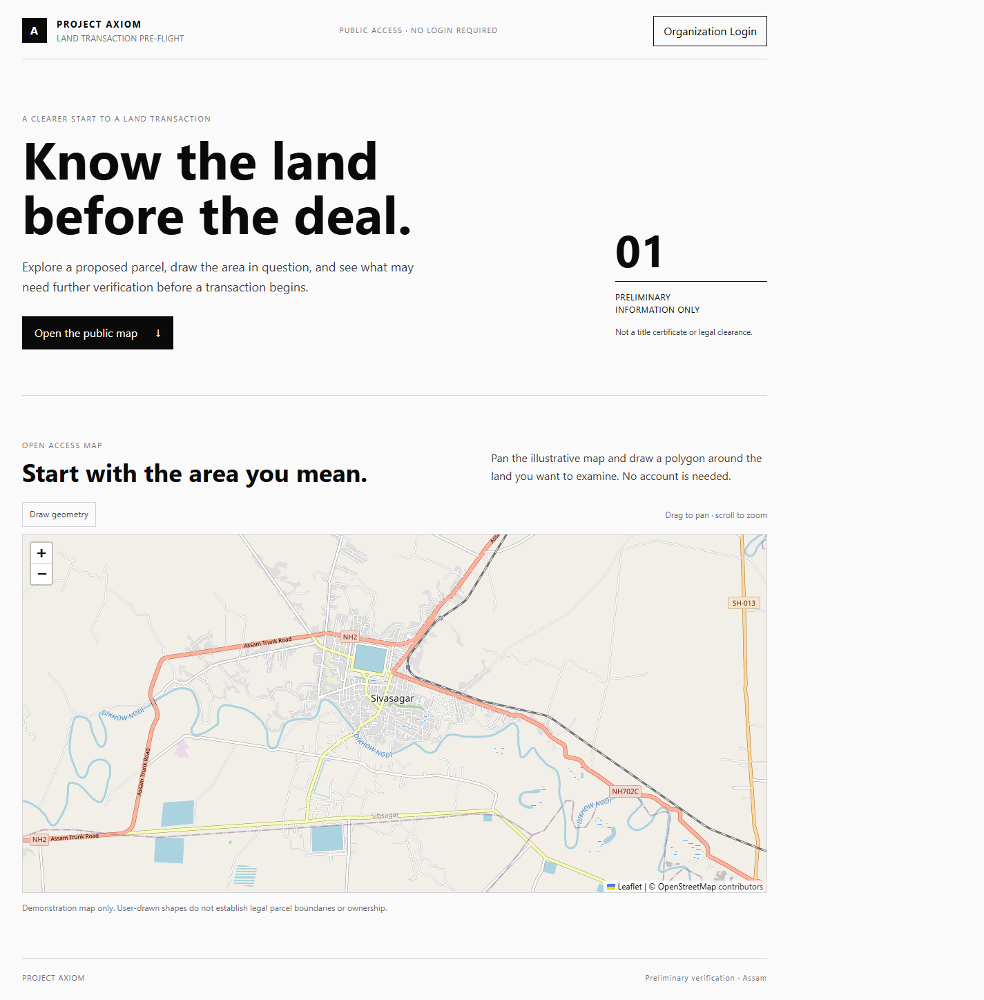
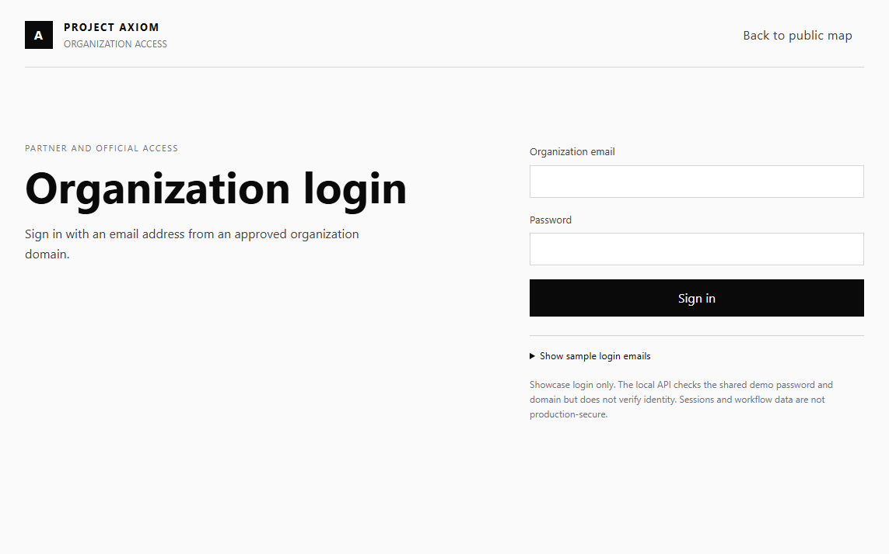
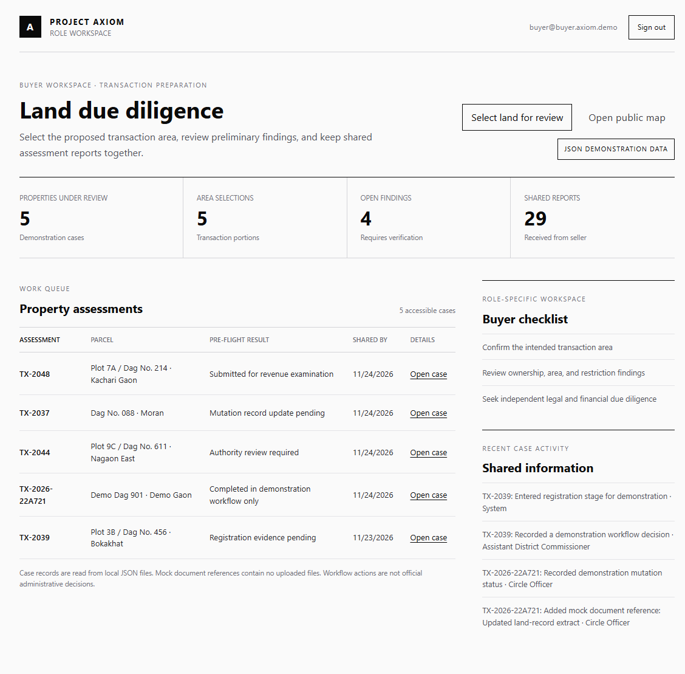
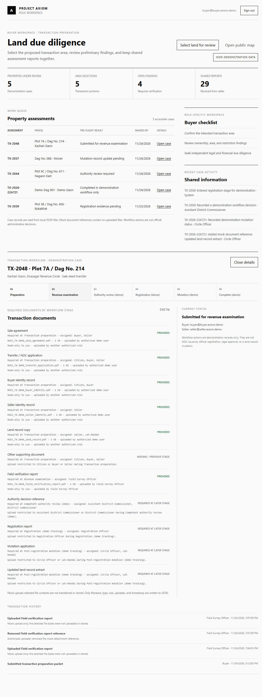

# Project Axiom

### NESFIC D-51

Project Axiom helps you explore a proposed land area, review sample pre-flight findings, and follow a transaction preparation workflow. This repository contains a local demonstration app with a public map and role-based workspaces.

**Demo only:** Assessments and workflow entries are illustrative. They do not establish ownership or title, provide legal clearance, issue an NOC, register a transaction, or change government land records. Always verify information with the competent authority and seek independent professional advice.

## What you can do

- Open the public map without signing in and draw an illustrative area.
- Sign in to a sample role workspace and review its transaction queue.
- Create a preparation case as a Citizen, Buyer, or Seller.
- Add mock document references, review findings, and follow the case activity trail.
- Advance a case through the demonstration stages using the role assigned to each step.

## Start the app

You need a recent version of Node.js and npm. From the project folder, run:

```bash
npm install
npm run dev
```

Open the local URL printed by Vite, usually <http://localhost:5173>. The `dev` command starts both the web app and its local API. Keep the terminal open while using the demo; press `Ctrl+C` to stop it.

To create a production build, run `npm run build`. To preview that build locally, run `npm run preview`.

## 1. Explore the public map

The landing page is open to everyone. Choose **Open the public map**, then:

1. Pan and zoom to explore the illustrative map.
2. Choose **Draw geometry** and click at least three points to sketch a polygon.
3. Choose **Finish shape** to complete it. Use the map controls to undo or clear shapes.

The drawn shape is for demonstration and does not identify a legally surveyed parcel or prove its boundaries. Use **Undo** to remove the last point or completed shape, and **Clear drawings** to remove all drawn shapes. The public map does not require an account.



## 2. Sign in to a sample workspace

Choose **Organization Login** from the landing page. Use one of the sample emails below and the shared demo password:

```text
Axiom@2026
```

| Workspace | Sample email |
|---|---|
| Citizen | `citizen@citizen.axiom.demo` |
| Buyer | `buyer@buyer.axiom.demo` |
| Seller | `seller@seller.axiom.demo` |
| Circle Officer | `officer@circle-office.assam.gov.in` |
| Registration Officer | `officer@register-office.assam.gov.in` |
| Bank | `reviewer@bank.gov.in` |
| Field Survey Officer | `surveyor@field-survey.axiom.demo` |
| Lat-Mandal | `latmandal@lat-mandal.axiom.demo` |
| Assistant District Commissioner | `adc@adc.assam.gov.in` |
| District Commissioner | `dc@dc.assam.gov.in` |

These are showcase credentials. The local app checks the email domain and shared password; it does not verify a person's identity or their authority. Choose a role that matches the task you want to explore. A Bank workspace is read-only.



## 3. Review the workspace

The workspace shows cases your role can access, recent activity, and a role-specific checklist. Open a case to see its parcel and transaction details, document checklist, current stage, available actions, and event history.



### Create a preparation case

Citizens, Buyers, and Sellers can create a case from their workspace. Enter the requested parcel, location, transaction, area, and participant details. The case begins in **Preparation** and is available to its participants and the workflow roles that can access it.

### Add document references

The checklist shows what is needed now, what is needed in a later stage, and who is responsible for each item. Only the assigned roles can add a reference during its active stage. The person who added a reference can replace or remove it while that stage is active; other users can view it.

The file picker accepts PDF, JPEG, and PNG files up to 25 MB. **The file contents are not uploaded or saved.** The demo stores only a mock reference with the filename, type, size, uploader, and time in local JSON data. Do not use real or sensitive documents.

Preparation documents include the sale agreement, transfer/NOC application, buyer and seller identity records, land record copy, and supporting document. Later stages request a field verification report, authority decision reference, registration report, mutation application, and updated land-record extract.

### Follow the case stages

| Stage | Who can act in the demo | What happens |
|---|---|---|
| Preparation | Citizen, Buyer, or Seller | Add the preparation document references and submit the packet when the checklist is complete. |
| Revenue examination | Circle Officer or Lat-Mandal; Field Survey Officer submits field findings | Review the case, record findings, and add the field report. |
| Authority review (demo) | Assistant District Commissioner or District Commissioner | Record a demonstration workflow status and its authority reference. |
| Registration (demo) | Registration Officer | Add a registration report and record the demonstration step. |
| Mutation (demo) | Circle Officer or Lat-Mandal | Add mutation references and record the demonstration step. |
| Complete (demo) | Viewable by case participants and authorized roles | Review the event trail for the completed demo workflow. |

Available actions depend on the case stage, your role, and checklist completion. The activity trail records case changes and mock document reference changes.



## Understanding findings

Read the explanation attached to a finding and note what needs follow-up. A status is a prompt for further examination, not a legal determination. In the demonstration workspace, sample parcels and records are illustrative; they are not a live connection to authoritative land-record systems.

## Local demo data and reset

Workflow cases are stored in [`data/transactions.json`](data/transactions.json); mock document metadata is stored in [`data/mock-files.json`](data/mock-files.json). Actions update these files, so changes persist across local restarts. Back up both files before trying the workflow if you want to restore your starting data later. Avoid running multiple demo instances against the same data files.

The server uses in-memory sessions and local JSON files. This setup is intended for a single-user showcase, not concurrent or production use. Do not put sensitive information into it.

## Troubleshooting

- **The page cannot load cases:** Start the app with `npm run dev` so both the API and web server are running.
- **Sign-in is rejected:** Use one of the exact sample email addresses above and `Axiom@2026`.
- **An action is unavailable:** Check that your role is authorized for the current stage and that required earlier-stage documents are present.
- **A document is read-only:** Only its authorized uploader can replace or remove it, and only during its active workflow stage.

## Project structure

```text
src/                  React user interface
server/index.js       Local Express workflow API
data/                 Demonstration cases and mock file metadata
docs/screenshots/     Onboarding screenshots
```

Project Axiom is a prototype for preliminary land-transaction decision support in Assam. Available checks depend on the illustrative data in this demo; no official land-record integration is implied.
