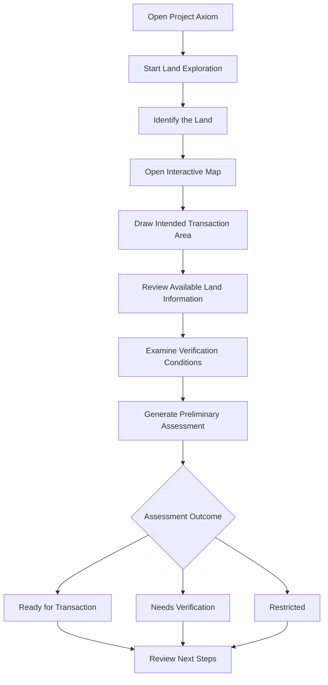
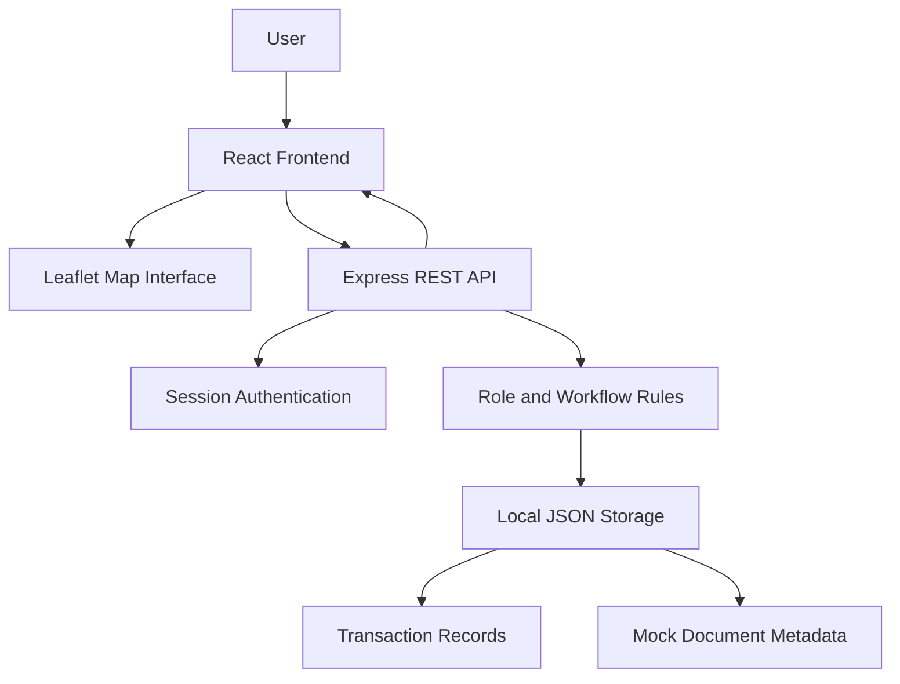

# Project Axiom

### NESFIC-D-51 | Land Transaction Pre-Flight Check

**Spot problems before a transaction starts.**

Project Axiom is a digital land transaction pre-flight verification prototype designed to help stakeholders identify potential discrepancies, restrictions, and documentation issues before initiating a land transaction.

Developed in response to the NESFIC-D-51 problem statement, Axiom explores how geographical land selection, preliminary record examination, and structured administrative workflows can be brought together into a unified application.

**Core proposition: Know what needs to be verified before initiating a land transaction.**

---

## Table of Contents

- [1. The Problem](#1-the-problem)
- [2. The Proposed Solution](#2-the-proposed-solution)
- [3. Target Users](#3-target-users)
- [4. Features](#4-features)
- [5. User Journey](#5-user-journey)
- [6. Technical Architecture](#6-technical-architecture)
- [7. Technology Stack](#7-technology-stack)
- [8. Data and Verification Methodology](#8-data-and-verification-methodology)
- [9. Current Implementation](#9-current-implementation)
- [10. Development and Testing](#10-development-and-testing)
- [11. Security and Limitations](#11-security-and-limitations)
- [12. Novelty and Differentiation](#12-novelty-and-differentiation)
- [13. Future Scope](#13-future-scope)
- [14. Relationship with NESFIC-D-52](#14-relationship-with-nesfic-d-52)
- [15. Getting Started](#15-getting-started)
- [16. Project Documentation](#16-project-documentation)

---

## 1. The Problem

Land transactions involve the examination of multiple aspects of a land parcel, including:

- Ownership records and mutation history.
- Recorded land area and classification.
- Government restrictions.
- Encumbrances and other recorded liabilities.
- Cadastral boundaries and geographical information.
- Supporting documents and administrative requirements.

These pieces of information may be distributed across different records, registers, documents, and administrative systems.

Consequently, discrepancies may be identified only after a transaction or administrative application has already been initiated.

This can result in repeated document submissions, application rejection, administrative delays, additional expenditure, and potential disputes.

### The gap

There is an opportunity for a preliminary verification mechanism that allows stakeholders to examine available land information before proceeding with a transaction.

Project Axiom addresses this gap by introducing a structured pre-flight assessment stage.

**Intended outcome:** Identify potential problems earlier, improve transaction preparedness, and reduce avoidable administrative effort.

## 2. The Proposed Solution

Project Axiom introduces a digital interface for preliminary land transaction verification.

Users can explore a geographical area, draw a polygon representing the land they intend to examine, and review an illustrative assessment of the associated land information.

The broader system also demonstrates how different stakeholders can participate in a structured transaction-preparation and administrative review workflow.

### Assessment outcomes

Axiom uses three primary assessment categories:

| Outcome | Interpretation |
|---|---|
| Ready for transaction | No material issue identified within the available demonstration checks |
| Needs Verification | One or more unresolved conditions require further examination |
| Restricted | A recorded restriction or blocking condition has been identified |

An assessment is accompanied by explanations, verification conditions, and suggested next steps.

The outcomes are preliminary indicators, not legal clearances or ownership certifications.

## 3. Target Users

Project Axiom considers several stakeholders in the land transaction ecosystem.

| User | Intended benefit |
|---|---|
| Citizens | Understand potential issues associated with their land |
| Buyers | Examine available information before purchasing land |
| Sellers | Identify discrepancies before initiating a transaction |
| Revenue Circle Officials | Review land information and unresolved conditions |
| Registration Officials | Examine preliminary transaction assessments |
| Field Survey Officers | Support geographical and field-level verification |
| Lat-Mandals | Participate in record examination and mutation-related workflows |
| District Administration | Monitor verification activities and unresolved cases |
| Banks | Organise preliminary property information for further due diligence |
| Legal Practitioners | Use structured information to support legal examination |

## 4. Features

### 4.1 Geographical Land Exploration

- Interactive map based on Leaflet.
- OpenStreetMap tile integration.
- Map navigation and zooming.
- Polygon drawing interface.
- Multiple polygon support.
- Basic drawing controls, including undo and clear.

The current drawing interface is demonstrative. User-drawn geometry is not yet connected to an authoritative cadastral boundary dataset or a complete spatial verification engine.

### 4.2 Preliminary Assessment Interface

The application demonstrates:

- Parcel identification.
- Recorded ownership information.
- Land area and selected transaction area.
- Mutation history.
- Risk indicators.
- Verification conditions.
- Assessment explanations.
- Recommended next steps.

### 4.3 Verification Conditions

The demonstration assessments cover conditions such as:

- Ownership validation.
- Area consistency.
- Encumbrance examination.
- Government restriction checks.
- Document readiness.

Each condition is represented with an explanatory status.

### 4.4 Role-Based Workspaces

Axiom demonstrates different interfaces for:

- Citizens.
- Buyers and sellers.
- Circle Officers.
- Registration Officers.
- Banks.
- Assistant District Commissioners.
- District Commissioners.
- Field Survey Officers.
- Lat-Mandals.

### 4.5 Transaction Workflow

The backend demonstrates a staged transaction-preparation workflow:

1. Transaction preparation.
2. Revenue examination.
3. Competent authority review.
4. Registration tracking.
5. Mutation tracking.
6. Demonstration workflow completion.

### 4.6 Document Checklist

The workflow includes:

- Stage-specific document requirements.
- Role-based upload permissions.
- Document reference management.
- Missing-document indicators.
- Document replacement and removal.
- Uploader attribution.

The current implementation stores document metadata only. It does not upload or retain the actual file contents.

### 4.7 Assessment and Activity Records

The application demonstrates:

- Transaction identifiers.
- Assessment summaries.
- Verification findings.
- Workflow events.
- Actor and role attribution.
- Timestamps.
- Administrative activity histories.

---

## 5. User Journey

The intended primary user journey is:



The broader transaction workflow allows participants to initiate a transaction-preparation case, manage document requirements, submit it for examination, and track subsequent demonstration workflow stages.

The workflow distinguishes between preliminary assessment and official administrative decisions.

---

## 6. Technical Architecture

Project Axiom currently follows a client-server architecture.



### Frontend

The frontend is implemented using React and Vite.

Its responsibilities include:

- Rendering the application interface.
- Managing application state.
- Displaying geographical information.
- Supporting polygon drawing.
- Presenting assessment details.
- Displaying role-specific dashboards.
- Communicating with the backend API.

### Backend

The backend uses Node.js and Express.

Its responsibilities include:

- Authentication and session management.
- Role-based workflow permissions.
- Transaction creation and retrieval.
- Document checklist management.
- Workflow stage transitions.
- Activity and event recording.
- Persistence of demonstration records.

### Persistence

The current prototype uses local JSON files for persistence.

This approach supports a lightweight demonstration environment without requiring an external database service.

A production implementation would require a more robust persistence architecture.

---

## 7. Technology Stack

| Layer | Technology |
|---|---|
| Frontend framework | React 19 |
| Build tool | Vite 8 |
| Programming language | JavaScript (ES Modules) |
| Backend runtime | Node.js |
| Backend framework | Express 5 |
| Session management | express-session |
| Mapping library | Leaflet |
| React mapping integration | React Leaflet |
| Map tiles | OpenStreetMap |
| Data persistence | JSON files |
| Development process management | concurrently |
| Linting | Oxlint |

### External geographical resources

- [OpenStreetMap](https://www.openstreetmap.org/)
- [Leaflet](https://leafletjs.com/)
- [React Leaflet](https://react-leaflet.js.org/)

The current implementation does not yet integrate Supabase, Google Maps, or an authoritative Assam government land-record API.

---

## 8. Data and Verification Methodology

Axiom's intended verification framework considers several categories of land-related information.

| Data category | Intended examination |
|---|---|
| Ownership records | Identify inconsistencies in recorded ownership |
| Mutation history | Examine recorded ownership changes |
| Land area | Compare recorded and proposed transaction areas |
| Land classification | Identify relevant classification differences |
| Encumbrances | Identify recorded liabilities requiring examination |
| Government restrictions | Surface relevant recorded restrictions |
| Geospatial information | Compare geographical representations |
| Supporting documents | Examine document availability and completeness |

### Current prototype data

The prototype uses predefined demonstration parcel records and local JSON workflow datasets.

These datasets provide illustrative cases for exploring different assessment outcomes and stakeholder workflows.

They are not connected to live government land-record systems.

### Future data requirements

A more comprehensive implementation would require access to appropriately authorised and reliable datasets, potentially including:

- Land and revenue records.
- Patta and Dag information.
- Mutation records.
- Cadastral maps.
- Geospatial boundary datasets.
- Encumbrance information.
- Relevant government notifications.
- Supporting transaction documents.

Potential data formats include JSON, CSV, PDF, and geospatial formats such as GeoJSON.

Data availability, licensing, quality, update frequency, and authorised access must be established before integration.

---

## 9. Current Implementation

The repository currently demonstrates the following capabilities.

| Capability | Implementation status |
|---|---|
| Public landing page | Implemented |
| Interactive Leaflet map | Implemented |
| Polygon drawing interface | Implemented |
| Demonstration parcel records | Implemented |
| Three assessment outcomes | Implemented as predefined examples |
| Verification condition display | Implemented as predefined examples |
| Role-specific dashboards | Implemented |
| Session-based demonstration login | Implemented |
| Transaction creation | Implemented |
| Document checklist | Implemented |
| Mock document metadata management | Implemented |
| Multi-stage transaction workflow | Implemented |
| Workflow event history | Implemented |
| Downloadable TXT assessment summary | Implemented |
| Live government land-record integration | Not implemented |
| Automated cadastral verification | Not implemented |
| Authoritative ownership verification | Not implemented |
| Persistent geospatial assessment pipeline | Not implemented |
| Actual document file storage | Not implemented |
| Production authentication | Not implemented |

The implementation status refers to functionality present in the repository. It does not imply production readiness or independent validation of the underlying land information.

---

## 10. Development and Testing

The project is being developed incrementally, with emphasis on demonstrating the core user journey and administrative workflow.

### Development stages

| Stage | Focus |
|---|---|
| Discovery | Understand the land transaction problem and existing workflow |
| Requirements | Define users, functional requirements, and system boundaries |
| Design | Establish application structure and user journeys |
| Prototype | Build the interactive application and demonstration assessments |
| Workflow implementation | Introduce role-specific transaction and document workflows |
| Validation | Examine functional correctness, usability, and workflow behaviour |
| Refinement | Improve reliability, data handling, and extensibility |

### Proposed validation measures

Future validation should examine:

- Correctness of transaction-stage transitions.
- Enforcement of role-based permissions.
- Identification of missing documents.
- Accuracy of geographical calculations.
- Consistency of verification outcomes.
- Traceability of workflow events.
- Usability across different stakeholder roles.
- Performance under representative workloads.

A representative test dataset should include consistent, inconsistent, incomplete, and restricted land-record scenarios.

No formal accuracy benchmark or independent field-validation result is currently claimed.

---

## 11. Security and Limitations

Land-related information can contain sensitive personal and property information. Consequently, production deployment would require appropriate security and governance controls.

The current prototype has several explicit limitations.

### Authentication

The demonstration authentication mechanism uses a shared password and accepted email domains.

It does not establish the identity of an individual or verify their employment or official authority.

### Data Storage

Local JSON files are used for persistence. This is suitable for a demonstration but not a production multi-user government system.

### Document Handling

Only document metadata is stored. Actual document contents are not transferred or retained.

### Official Decisions

Workflow actions represent demonstration statuses, not official approvals, NOC issuance, registration, or mutation.

### Geographical Information

The interactive map uses OpenStreetMap tiles. User-drawn polygons do not establish legally recognised parcel boundaries.

### Production Requirements

A production implementation would require:

- Strong authentication and identity verification.
- Fine-grained role-based access control.
- Secure database permissions.
- Encryption in transit and at rest.
- Secure document storage.
- Comprehensive audit logging.
- Data retention and privacy policies.
- Authoritative data provenance.
- Human review of consequential findings.
- Compliance with applicable Indian data protection and land-administration requirements.

**Project Axiom is a preliminary decision-support prototype. It does not establish legal ownership, guarantee transaction validity, or replace statutory verification by competent authorities.**

---

## 12. Novelty and Differentiation

Project Axiom explores the idea of introducing a structured pre-flight verification layer into the land transaction process.

Its intended differentiation lies in bringing together:

1. Geographical identification of the intended transaction area.
2. Preliminary examination of available land information.
3. Multiple verification conditions.
4. Explainable assessment outcomes.
5. Role-specific administrative workflows.
6. Transaction preparation and document readiness.

Existing land-record portals, cadastral mapping platforms, and administrative systems primarily serve their respective information or service-delivery purposes.

Axiom explores how information from relevant sources could eventually be brought into a unified preliminary assessment workflow.

Its differentiation is therefore centred on the integration and presentation of verification activities rather than the creation of another standalone land-record viewer.

The proposed system builds upon existing geographical and land-administration infrastructure.

---

## 13. Future Scope

The longer-term development roadmap includes several areas.

### 13.1 Geospatial Verification

- Integration of authoritative cadastral datasets.
- Parcel boundary identification.
- Sub-parcel selection and area calculation.
- Geometrical comparison against official records.
- Detection of overlapping or inconsistent boundaries.

### 13.2 Land Record Integration

- Integration with authorised land-record sources.
- Ownership and mutation history examination.
- Land classification verification.
- Government restriction identification.
- Encumbrance and court-related information retrieval, where available.

### 13.3 Verification Engine

- A modular rule-based verification engine.
- Source-aware validation.
- Confidence and uncertainty representation.
- Explainable findings.
- Historical assessment comparison.

### 13.4 Infrastructure

- Migration from local JSON files to a managed database.
- Secure document storage.
- Strong authentication and authorisation.
- Scalable application deployment.
- Improved auditability.

### 13.5 Administrative Integration

- Enhanced stakeholder dashboards.
- Field verification workflows.
- Authorised administrative review.
- Integration with existing land-administration processes.

These capabilities depend on technical feasibility, data availability, institutional cooperation, and appropriate authorisations.

---

## 14. Relationship with NESFIC-D-52

Project Axiom is developed under **NESFIC-D-51: Land Transaction Pre-Flight Check**.

It is also intended to provide a verification foundation for the broader **NESFIC-D-52: Assam Land Exchange** initiative.

The two initiatives have complementary responsibilities:

| Initiative | Primary responsibility |
|---|---|
| NESFIC-D-51 — Project Axiom | Preliminary land verification and transaction-readiness assessment |
| NESFIC-D-52 — Assam Land Exchange | Land discovery and exchange with an assisted transaction workflow |

Axiom is intended to evolve into a reusable verification component that D-52 can eventually incorporate.

The initiatives maintain separate development objectives and scopes.

---

## 15. Getting Started

### Prerequisites

- Node.js
- npm
- Git

### Installation

Clone the repository:

```bash
git clone https://github.com/RaktimJS/project_axiom.git
cd project_axiom
```

Install dependencies:

```bash
npm install
```

Start the development environment:

```bash
npm run dev
```

This starts the Express API and Vite development server concurrently.

The application is generally accessible at:

```text
http://localhost:5173
```

The API runs on:

```text
http://localhost:3001
```

### Available Scripts

| Command | Description |
|---|---|
| `npm run dev` | Starts the frontend and backend |
| `npm run dev:web` | Starts the Vite frontend |
| `npm run dev:api` | Starts the Express API |
| `npm run build` | Builds the frontend |
| `npm run preview` | Previews the frontend production build |
| `npm run lint` | Runs Oxlint |

### Environment Configuration

The backend supports the following environment variables:

| Variable | Purpose |
|---|---|
| `API_PORT` | Backend server port |
| `DEMO_LOGIN_PASSWORD` | Shared demonstration login password |
| `SESSION_SECRET` | Express session signing secret |

The current backend includes insecure development defaults. Configure these values appropriately even for controlled demonstrations.

The current local JSON persistence and demonstration authentication are not suitable for production deployment.

---

## 16. Project Documentation

The repository includes a Product Requirements Document:

- [`PRD.md`](./PRD.md) — Product vision, requirements, scope, target stakeholders, workflows, and functional specifications.

For the official challenge description:

- [NESFIC-D-51: Land Transaction Pre-Flight Check](https://startup.assam.gov.in/nesfic26/problem-statements/nesfic-d-51)

---

## Project Information

| Attribute | Details |
|---|---|
| Project | Project Axiom |
| Challenge | NESFIC-D-51 |
| Official title | Land Transaction Pre-Flight Check |
| Domain | GovTech / Land Administration / Geospatial Technology |
| Geographic focus | Assam, India |
| Project stage | Prototype |
| Related initiative | NESFIC-D-52 — Assam Land Exchange |
| Repository | [RaktimJS/project_axiom](https://github.com/RaktimJS/project_axiom) |

---

**Project Vision**

To make preliminary land verification an accessible and structured part of the land transaction process, helping stakeholders identify potential problems before they become transaction problems.

*Project Axiom is a prototype-stage initiative. Demonstration data, simulated administrative actions, and proposed integrations are explicitly distinguished from authoritative government records and production functionality.*